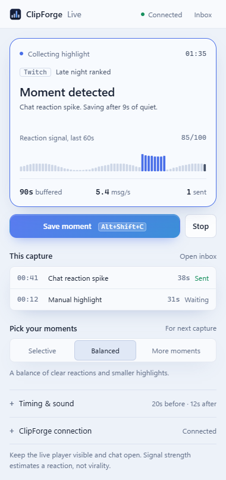

<div align="center">


# ClipForge Live

**Catch it before chat erupts.**
A Chrome extension that buffers the Twitch or YouTube stream you're watching and saves a clip when chat reacts, with the setup before and the ending after.

Chrome 116+ · Manifest V3 · works with [ClipForge](https://github.com/generalworksit/clipforge) on your PC

[](https://github.com/generalworksit/clipforge-live/stargazers) [](LICENSE) [](https://github.com/generalworksit/clipforge-live/commits/main)

</div>

<table>
<tr>
<td width="380"><picture><source media="(prefers-color-scheme: dark)" srcset="docs/popup-dark.png"></picture></td>
<td>

**What you see while it runs**

- **Signal graph.** The last 60 seconds of chat reaction, one bar per second. Bars turn yellow while a highlight is being collected
- **Source line.** Which stream is being captured, so you never record the wrong tab
- **This capture.** Every clip from the session with its time, reason, length and whether it reached ClipForge
- **Connection dot** in the top bar: green when the app is reachable
- **Light and dark** follow your system setting

Nothing to watch closely though. Leave the tab open and clips arrive in ClipForge's **Live clips** inbox on their own.

</td>
</tr>
</table>

## How it works

```
stream tab ──► rolling video buffer (in the extension, ~2.5 min)
     │
chat lines ──► reaction detector ──► spike? keep 20 s before + until chat calms (12 s)
                                         │
                                         ▼
                         clip sent to ClipForge on 127.0.0.1 ──► clean MP4 in Live clips
```

- The detector learns the chat's normal pace for 20 seconds, then looks for sudden jumps in messages, many different viewers reacting at once, and reaction words or emotes. Spam and repeated copy-paste are filtered out.
- A clip keeps the lead-in, the moment, and the ending until chat settles, up to 90 seconds.
- A sudden group of different viewers asking "clip that" can flag a moment too. English, French and Russian requests are recognized; negated requests and repeat spam are filtered.
- Press **Save moment** or `Alt+Shift+C` to clip something yourself at any time.
- If ClipForge is closed, up to 6 finished clips wait inside the extension. Press **Retry uploads** once the app is back.

## Install

1. Install and start [ClipForge](https://github.com/generalworksit/clipforge). Double-clicking `run.bat` sets everything up.
2. Get this extension: **Code → Download ZIP** and extract it, or `git clone https://github.com/generalworksit/clipforge-live.git`.
3. Open `chrome://extensions`, turn on **Developer mode**, press **Load unpacked** and pick the folder.
4. Pin **ClipForge Live** in the toolbar and press **Connect app** in its popup. The connection is saved, you do this once.

Edge, Brave and other Chromium browsers should work the same way (tested in Chrome).

## Use

1. Open a live stream on Twitch or YouTube with its chat visible.
2. Press **Start capture**. The badge shows **REC**.
3. Keep the player visible and playing. Watch normally.
4. Press **Stop** when you're done. Clips are already in ClipForge.

## Settings

| Setting | Default | What it changes |
|---|---|---|
| Sensitivity | Balanced | **Selective** waits for big sustained reactions, **More moments** catches smaller ones |
| Lead-in | 20 s | How much of the setup is kept before the reaction |
| Quiet ending | 12 s | How long chat must calm down before the clip ends |
| Maximum | 90 s | Longest clip allowed |
| Sound spikes | off | Also triggers on loud audio jumps. Music and ads can set it off |
| Silent monitoring | off | Mutes speaker playback while preserving captured audio; leave the website player unmuted |
| Port | 8000 | Change only if ClipForge runs on another port |

Changes apply to the next capture. The shortcut can be changed in `chrome://extensions/shortcuts`.
Silent monitoring changes immediately. For multiple recordings without tabs, use ClipForge's YouTube **Auto monitor**; the extension itself still captures one tab at a time.

## Privacy

- Video and chat never leave your PC. The only network target is ClipForge on `127.0.0.1`.
- Chat usernames are hashed with a random salt in the page and only counted, never stored or sent.
- Pairing runs only when you press **Connect app**, and the connection key is kept in Chrome's local extension storage. Websites can't control the recorder.
- Nothing is posted anywhere.

| Permission | Why |
|---|---|
| `tabCapture` | record the stream tab you start capture on |
| `activeTab`, `scripting` | read that tab's chat and player position, only after you press Start |
| `offscreen` | keep the recorder running while the popup is closed |
| `storage` | remember the connection and your settings |
| `127.0.0.1`, `localhost` | send clips to ClipForge |

## Limits

- The stream tab has to stay open, visible and playing at normal speed. Ads and overlays inside the player are recorded too.
- Kick isn't supported yet.
- The signal measures how strongly chat reacts, not whether a clip will go viral. Review clips before posting.
- Only capture streams you have the right to clip.

## Development

Plain JavaScript, no build step. Edit, then press the reload icon on the extension card.

| File | Role |
|---|---|
| `background.js` | service worker: pairing, start/stop, tab checks, badge |
| `offscreen.js` | recorder: tab capture, 4 s segments, rolling buffer, upload queue |
| `detector.mjs` | chat reaction detector, shared with ClipForge's Auto monitor |
| `content.js` | reads new chat lines and the player position on Twitch and YouTube |
| `popup.*` | the popup UI |

Tests live in the [ClipForge repo](https://github.com/generalworksit/clipforge/tree/main/tests) (`tests/live_*.mjs`, `tests/browser_popup.py`, `tests/browser_live.py`).

## Related projects

| | |
|---|---|
| **[ClipForge](https://github.com/generalworksit/clipforge)** | The app this extension sends clips to: clip maker with captions, downloader, subtitles, converter, AI voice and the Live clips inbox. Required, runs on your PC |

## Star history

<a href="https://star-history.com/#generalworksit/clipforge&generalworksit/clipforge-live&Date">
 <picture>
   <source media="(prefers-color-scheme: dark)" srcset="https://api.star-history.com/svg?repos=generalworksit/clipforge,generalworksit/clipforge-live&type=Date&theme=dark" />
   <source media="(prefers-color-scheme: light)" srcset="https://api.star-history.com/svg?repos=generalworksit/clipforge,generalworksit/clipforge-live&type=Date" />
   
 </picture>
</a>

The chart updates on its own as people star either repo.

## License

[MIT](LICENSE)
